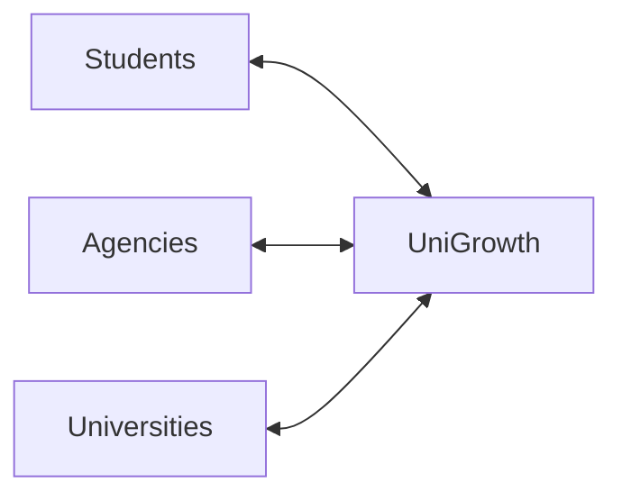

# Idea

## Vision
UniGrowth is a three-sided platform that connects **students**, **agencies** and **universities** in the study-abroad journey. Students are the most valuable side: the platform exists to help them find the right university, program and degree, and the right agency to guide them.

## Problem it solves
- **Students** struggle to find suitable universities, programs and degrees, and to find trustworthy agencies that help them study abroad.
- **Agencies** that help students study abroad need a way to reach students and universities.
- **Universities** need a way to find and reach students who are genuinely interested in them.

## Audience and value

| Side | Who | What UniGrowth gives them |
| --- | --- | --- |
| Students (most valuable) | University applicants, mainly those looking to study abroad | Find universities, find agencies, find the correct programs and degrees |
| Agencies (B2B) | Study-abroad and education consultancies | A B2B service that connects them to students and to universities |
| Universities | Institutions recruiting students | A platform to find and help students who are interested in them |

## How the sides connect

UniGrowth sits in the middle. It links agencies to students and to universities, and universities to interested students.

## Core capabilities (from the vision)
- Students discover universities, programs and degrees that fit them.
- Students discover agencies that can help them.
- Agencies are connected to students and to universities (B2B).
- Universities find and engage interested students.

## Out of scope
_TBD. Not defined yet._

## Decisions
| Topic | Decision |
| --- | --- |
| Payment (agencies, universities) | Paid in person, offline. No online payment in the product. |
| Student pricing | Free for students. |
| Verification | Agencies and universities are verified manually in an admin panel. |
| Countries and universities | Added manually through the admin panel. No fixed launch list. |
| Student profile and matching | Not defined yet. Will be defined later. |
| Backend | None for now. The product stays **frontend-only** and uses **mock data**. The focus is on users and UX first. A backend is built later, once the data and flows are clear. |

## Implications
- Needs an **admin panel** (manual verification, adding countries and universities), still on mock data for now.
- Needs **no payment or billing** features.
- All data (students, agencies, universities, programs) lives in mock data in the frontend. Keep it in one data layer so it can be replaced by a real API later without rewriting the UI.

## Open questions
- What does a student profile contain, and how is matching done? (to be defined later)
- What are the MVP scope and out-of-scope items?
- Who can access the admin panel while there is no backend (auth is mocked)?

## Success criteria
_TBD._

## Known facts
- Name: **UniGrowth**
- Logo concept: `g` + `U` + arrow (growth) combined into one mark (see [design.md](./design.md)).
- Current state: static placeholder page showing "Welcome to UniGrowth!".
